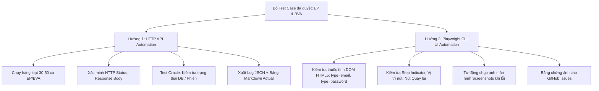
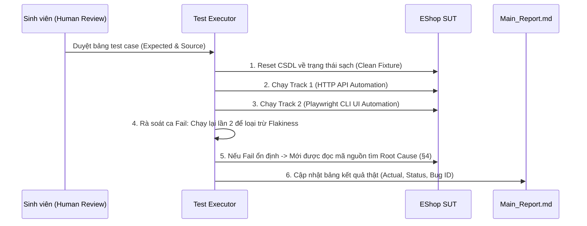
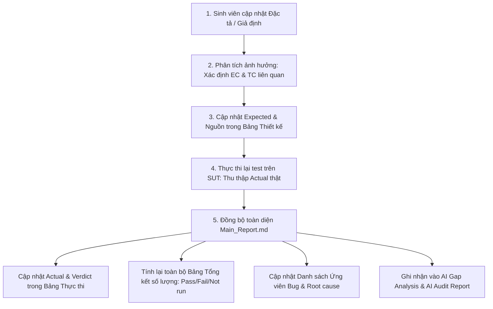

# HW02 Test Executor — Chiến lược Tự động hóa Kiểm thử 2 Hướng

> **Nguyên tắc cốt lõi:**  
> 1. **Thiết kế ≠ Thực thi:** Ca kiểm thử chỉ được tính là đã chạy khi có **lệnh thật** và **kết quả thật**. Ca chưa chạy bắt buộc ghi `Not run`. Tuyệt đối **không bịa Actual**.  
> 2. **Clean Code & Đọc hiểu (Readability):** Mã kiểm thử phải tuân thủ nguyên tắc đơn nhiệm (SRP), tên hàm thể hiện rõ ý định kiểm thử (`Intention-Revealing Names`), tách bạch giữa **Hành động (Action)**, **Xác minh (Oracle Assertion)** và **Dữ liệu mẫu (Fixture)**.  
> 3. **100% Tiếng Việt có dấu trong Code & Artifacts:** Mọi chuỗi mô tả bộ kiểm thử (`test.describe`), tên ca kiểm thử (`test`), thông báo lỗi assertion (`expect(..., 'thông báo lỗi tiếng Việt có dấu')`), console logs, chú thích mã nguồn (comments), báo cáo kết quả đều **BẮT BUỘC 100% tiếng Việt có dấu chuẩn xác**. Tuyệt đối **KHÔNG dùng tiếng Việt không dấu** nhằm đảm bảo mọi log, error context và báo cáo sinh ra (kể cả bởi Playwright test runner) luôn hiển thị tiếng Việt có dấu chuẩn mực.

---

## 1. TỔNG QUAN CHIẾN LƯỢC 2 HƯỚNG (DUAL-TRACK AUTOMATION)

Để đạt điểm tối đa theo yêu cầu đề bài HW02, quy trình kiểm thử được chia làm 2 nhánh tương hỗ:



| Tiêu chí | Hướng 1: HTTP API Automation | Hướng 2: Playwright CLI |
|---|---|---|
| **Mục đích** | Quét cạn toàn bộ độ phủ dữ liệu (Data & Boundary Coverage) và kiểm tra tính toàn vẹn trạng thái CSDL. | Kiểm tra trải nghiệm người dùng, xác thực form trình duyệt (Client-side HTML5), và tạo bằng chứng trực quan. |
| **Công cụ** | Node.js (`fetch` / `node:test`) hoặc PowerShell (`Invoke-RestMethod`). | `@playwright/test` CLI runner (Chromium / Firefox / WebKit). |
| **Tốc độ** | Rất nhanh (< 5 giây cho toàn bộ 40–50 ca). | Trung bình (15–30 giây cho luồng trình duyệt). |
| **Sản phẩm đầu ra** | File log `run_api.json`, bảng Markdown chứa Actual và lệnh tái hiện. | Ảnh chụp màn hình lỗi (`BUG-xxx.png`), video replay, báo cáo HTML của Playwright. |

---

## 2. HƯỚNG 1: HTTP API AUTOMATION (CLEAN ARCHITECTURE)

### 2.1. Cấu trúc mã nguồn Clean Code
Mã kịch bản API phải được chia thành 4 thành phần độc lập:

1. **`ApiClient`**: Đóng gói các lời gọi HTTP thuần túy, che giấu chi tiết cấu hình header/URL.
2. **`DatabaseFixture`**: Quản lý tạo lập CSDL sạch trước mỗi nhóm ca hoặc từng ca (tránh lỗi phụ thuộc dữ liệu chéo).
3. **`TestOracle`**: Các hàm nghiệp vụ độc lập dùng để xác minh trạng thái hệ thống sau khi gọi API (ví dụ: đăng nhập thử để xem mật khẩu thật sự có đổi hay không).
4. **`TestRunner`**: Lặp qua danh sách ca kiểm thử, đo lường thời gian, bắt ngoại lệ và ghi kết quả.

### 2.2. Mẫu triển khai Client & Oracle chuẩn mực (Node.js)

```javascript
/**
 * eshopApiClient.js — Client tương tác API EShop
 * Đặt tên hàm rõ ràng theo đúng nghiệp vụ đặc tả.
 */
class EshopApiClient {
  constructor(baseUrl = 'http://localhost:3000') {
    this.baseUrl = baseUrl.replace(/\/$/, '');
  }

  async sendJsonRequest(method, endpoint, payload = null) {
    const url = `${this.baseUrl}${endpoint}`;
    const options = {
      method: method.toUpperCase(),
      headers: { 'Content-Type': 'application/json' },
    };
    if (payload !== null && payload !== undefined) {
      options.body = JSON.stringify(payload);
    }

    try {
      const response = await fetch(url, options);
      const rawText = await response.text();
      let parsedJson = null;
      try { parsedJson = JSON.parse(rawText); } catch {}

      return {
        status: response.status,
        bodyText: rawText,
        data: parsedJson,
        isSuccess: response.status >= 200 && response.status < 300,
        isClientError: response.status >= 400 && response.status < 500,
      };
    } catch (networkError) {
      return {
        status: 0,
        bodyText: networkError.message,
        data: null,
        isSuccess: false,
        isClientError: false,
        networkError: true,
      };
    }
  }

  // --- Các hàm nghiệp vụ có tên định danh rõ ràng ---
  requestPasswordResetOtp(email) {
    return this.sendJsonRequest('POST', '/api/forgot-password', { email });
  }

  submitPasswordReset(email, resetToken, newPassword) {
    return this.sendJsonRequest('POST', '/api/reset-password', { email, resetToken, newPassword });
  }

  attemptLogin(email, password) {
    return this.sendJsonRequest('POST', '/api/login', { email, password });
  }
}

/**
 * eshopTestOracle.js — Hàm xác minh trạng thái dữ liệu độc lập
 */
class EshopTestOracle {
  /**
   * Oracle OC-NO: Xác minh mật khẩu KHÔNG bị đổi
   * Kỳ vọng: Đăng nhập bằng mật khẩu cũ phải THÀNH CÔNG (HTTP 200).
   */
  static async verifyPasswordRemainsUnchanged(client, email, oldPassword) {
    const loginResult = await client.attemptLogin(email, oldPassword);
    return {
      passed: loginResult.status === 200,
      actualDetail: `Login mật khẩu cũ '${oldPassword}' trả về HTTP ${loginResult.status}`,
    };
  }

  /**
   * Oracle OC-OK: Xác minh mật khẩu ĐÃ đổi thành công
   * Kỳ vọng: Đăng nhập bằng mật khẩu mới THÀNH CÔNG (200), mật khẩu cũ bị TỪ CHỐI (401).
   */
  static async verifyPasswordSuccessfullyUpdated(client, email, oldPassword, newPassword) {
    const newPassResult = await client.attemptLogin(email, newPassword);
    const oldPassResult = await client.attemptLogin(email, oldPassword);

    const isNewPassAccepted = newPassResult.status === 200;
    const isOldPassRevoked = oldPassResult.status !== 200;

    return {
      passed: isNewPassAccepted && isOldPassRevoked,
      actualDetail: `Login pass mới: HTTP ${newPassResult.status}; Login pass cũ: HTTP ${oldPassResult.status}`,
    };
  }
}

module.exports = { EshopApiClient, EshopTestOracle };
```

### 2.3. Lệnh thực thi Hướng 1
```powershell
# Chạy suite kiểm thử API tự động và xuất báo cáo
node reports/evidence/FR-03/run_fr03.js reports/evidence/FR-03/run_api_1

# Chạy lần 2 để kiểm chứng tính ổn định (loại trừ flakiness)
node reports/evidence/FR-03/run_fr03.js reports/evidence/FR-03/run_api_2
```

---

## 3. HƯỚNG 2: PLAYWRIGHT CLI AUTOMATION (UI & DOM TESTING)

### 3.1. Mục tiêu kiểm thử trên UI
Hướng 2 tập trung vào các yêu cầu không thể kiểm chứng qua API:
1. **Ràng buộc HTML5 DOM:** Thẻ `<input type="email">` có tự động kích hoạt `:invalid` và tooltip chặn submit khi email sai định dạng không? Thẻ mật khẩu có đúng `type="password"` để che ký tự không?
2. **Step Indicator:** Giao diện có hiển thị rõ "Bước 1 / 2" và "Bước 2 / 2" theo FR-03 & FR-22 không?
3. **Tính đầy đủ của form:** Form Bước 2 có ô "Xác nhận mật khẩu" để kiểm tra $V_5 = V_4$ không?
4. **Bằng chứng lỗi (Bug Artifacts):** Tự động chụp ảnh màn hình lưu vào `reports/evidence/` khi có assert thất bại.

### 3.2. Cấu trúc file kiểm thử Playwright Clean Code: `tests/fr03_reset_password.spec.js`

```javascript
const { test, expect } = require('@playwright/test');

const FRONTEND_URL = process.env.FRONTEND_URL || 'http://localhost:5173';
const EVIDENCE_DIR = 'reports/evidence/FR-03';

// Page Object thu nhỏ giúp code test trực quan và dễ bảo trì
class ForgotPasswordPage {
  constructor(page) {
    this.page = page;
    this.emailInput = page.locator('input[type="email"], input[name="email"]');
    this.requestOtpButton = page.locator('button:has-text("Lấy mã OTP"), button[type="submit"]');
    this.stepIndicator = page.locator('.step-indicator, text=/Bước [12] \\/ 2/i');
    this.otpInput = page.locator('input[name="otp"], input[placeholder*="OTP" i]');
    this.newPasswordInput = page.locator('input[name="newPassword"], input[placeholder*="mật khẩu mới" i]');
    this.confirmPasswordInput = page.locator('input[name="confirmPassword"], input[placeholder*="xác nhận" i]');
    this.submitResetButton = page.locator('button:has-text("Đổi mật khẩu"), button:has-text("Xác nhận")');
    this.backToLoginLink = page.locator('a:has-text("Quay lại"), button:has-text("Đăng nhập")');
  }

  async navigate() {
    await this.page.goto(`${FRONTEND_URL}/forgot-password`);
  }

  async submitEmailForOtp(email) {
    await this.emailInput.fill(email);
    await this.requestOtpButton.click();
  }
}

test.describe('FR-03 UI Automation: Quên & Đặt lại mật khẩu', () => {

  test('EP-TC30 (UI): Ô email phải có type="email" và kích hoạt HTML5 validation khi sai format', async ({ page }) => {
    const forgotPage = new ForgotPasswordPage(page);
    await forgotPage.navigate();

    // 1. Kiểm tra thuộc tính thẻ input
    await expect(forgotPage.emailInput).toHaveAttribute('type', 'email');

    // 2. Nhập email sai định dạng và cố gắng submit
    await forgotPage.emailInput.fill('testeshop.com');
    await forgotPage.requestOtpButton.click();

    // 3. Kiểm tra trình duyệt đã kích hoạt cờ :invalid của HTML5
    const isHtml5Invalid = await forgotPage.emailInput.evaluate((el) => !el.checkValidity());
    expect(isHtml5Invalid, 'Trình duyệt phải chặn submit khi email sai định dạng HTML5').toBe(true);
  });

  test('EP-TC29 (UI): Kiểm tra chỉ báo bước và nút "Quay lại đăng nhập"', async ({ page }) => {
    const forgotPage = new ForgotPasswordPage(page);
    await forgotPage.navigate();

    // Kiểm tra nút quay lại đăng nhập hoạt động đúng
    await expect(forgotPage.backToLoginLink).toBeVisible();
    await forgotPage.backToLoginLink.click();
    await expect(page).toHaveURL(/.*login/);
  });

  test('EP-TC02 / EP-TC22 & BUG-003 (UI): Form Bước 2 phải có trường Xác nhận mật khẩu và chỉ báo Bước 2/2', async ({ page }) => {
    const forgotPage = new ForgotPasswordPage(page);
    await forgotPage.navigate();

    // Bước 1: Yêu cầu cấp OTP
    await forgotPage.submitEmailForOtp('test@eshop.com');
    await page.waitForTimeout(1000); // Chờ chuyển bước

    // Chụp ảnh bằng chứng màn hình Bước 2 thực tế
    await page.screenshot({ path: `${EVIDENCE_DIR}/playwright_step2_actual.png`, fullPage: true });

    // Assert 1: Chỉ báo bước "Bước 2 / 2"
    await expect(forgotPage.stepIndicator, 'Phải có chỉ báo "Bước 2 / 2"').toBeVisible();

    // Assert 2: Trường mật khẩu mới phải che ký tự
    await expect(forgotPage.newPasswordInput).toHaveAttribute('type', 'password');

    // Assert 3: Form BẮT BUỘC phải có trường Xác nhận mật khẩu (SUT sẽ FAIL tại đây vì thiếu trường)
    await expect(
      forgotPage.confirmPasswordInput, 
      'LỖI UI (BUG-003): Form Bước 2 thiếu hoàn toàn ô Xác nhận mật khẩu'
    ).toBeAttached({ timeout: 3000 });
  });

});
```

### 3.3. Các lệnh Playwright CLI thường dùng
```powershell
# 1. Chạy ngầm toàn bộ kiểm thử UI và xuất kết quả console
npx playwright test tests/fr03_reset_password.spec.js

# 2. Chạy mở trình duyệt trực quan (headed) để quan sát từng thao tác click/fill
npx playwright test tests/fr03_reset_password.spec.js --headed

# 3. Mở UI Runner tương tác (rất hữu ích để quay video demo cho HW02)
npx playwright test --ui

# 4. Xuất báo cáo HTML trực quan kèm ảnh chụp màn hình
npx playwright show-report
```

---

## 4. QUY TRÌNH THỰC THI CHUẨN 6 BƯỚC



1. **Chuẩn bị điều kiện nền:** Khởi động backend (`localhost:3000`) và frontend (`localhost:5173`). Đảm bảo có script dọn dẹp DB sạch cho từng ca.
2. **Thực thi Track 1 (API):** Chạy toàn bộ các ca kiểm tra logic dữ liệu, biên độ dài, mã trạng thái.
3. **Thực thi Track 2 (UI Playwright):** Chạy kiểm thử tương tác DOM, chụp ảnh minh chứng các ca giao diện (`BUG-xxx.png`).
4. **Kiểm tra tính ổn định (Flakiness Test):** Mọi ca `Fail` đều phải được chạy lại ít nhất **1 lần nữa**. Nếu kết quả lần 1 và lần 2 giống hệt nhau $\rightarrow$ Xác nhận lỗi là ổn định (Deterministic Bug).
5. **Phân tích nguyên nhân gốc (Sau khi Fail):** Tuân thủ quy định §4: Chỉ khi test đã Fail thật mới được mở file mã nguồn (`server.js`, `ForgotPassword.jsx`) để định vị file và dòng code gây lỗi.
6. **Bàn giao kết quả:** Điền đầy đủ cột `Actual` và `Status` vào `Main_Report.md`. Chuyển danh sách bug sang skill `hw02_bug_reporter`.

### 4.2. QUY TRÌNH KHI CHỈNH SỬA ĐẶC TẢ VÀ CHẠY LẠI TEST (SPECIFICATION CHANGE & RE-EXECUTION WORKFLOW)

Khi người dùng/sinh viên điều chỉnh lại đặc tả (ví dụ: làm rõ câu hỏi mở Q1-Q5, thay đổi giả định cận biên, sửa quy tắc nghiệp vụ, chuẩn hóa mã lỗi), AI Executor **bắt buộc tuân thủ quy trình 5 bước lan truyền (Ripple Synchronization)** để cập nhật toàn diện `Main_Report.md`:



#### Chi tiết 5 bước đồng bộ:

1. **Phân tích ảnh hưởng (Impact Analysis):**
   - Xác định rõ trường thông tin hoặc quy tắc nào vừa thay đổi trong Mục 0 (Đặc tả).
   - Liệt kê chính xác danh sách các lớp tương đương (`ECxx`) và mã ca kiểm thử (`EP-TCxx`, `BV-TCxx`) chịu ảnh hưởng.

2. **Cập nhật Bảng Thiết kế & Oracle (Design & Oracle Update):**
   - Cập nhật lại cột `Kết quả mong đợi` và `Nguồn expected` của các ca liên quan trong Mục 1 (EP) và Mục 2 (BVA).
   - Giữ nguyên các ca không bị ảnh hưởng để đảm bảo tính ổn định của bộ test suite.

3. **Thực thi lại kiểm thử (Re-execution):**
   - Chạy lại các ca bị ảnh hưởng (hoặc toàn bộ test suite) bằng kịch bản HTTP API hoặc Playwright CLI.
   - Thu thập kết quả thực tế (`Actual Result`) và mã HTTP thật từ hệ thống SUT.

4. **Đánh giá lại kết quả (Re-evaluation):**
   - So sánh `Actual Result` mới với `Expected Result` mới theo đặc tả đã chỉnh sửa.
   - Xác định trạng thái mới: `Pass`, `Fail`, hoặc `Blocked`.

5. **Đồng bộ hóa toàn diện báo cáo `Main_Report.md` (Bắt buộc không bỏ sót):**
   - **Bảng thực thi (§3.1):** Cập nhật `Kết quả mong đợi`, `Kết quả thực tế`, `Trạng thái`, và liên kết `Bug ID`.
   - **Bảng tổng hợp số lượng (§Tổng hợp và §3.2):** Tính toán và cập nhật lại toàn bộ các con số `Pass`, `Fail`, `Blocked`, `Not run`. Đảm bảo số liệu giữa các bảng trùng khớp 100%, không mâu thuẫn.
   - **Phân tích ca Fail & Ứng viên Bug (§3.3):** Nếu ca test chuyển từ `Fail` sang `Pass` do đặc tả nới lỏng hoặc làm rõ, phải loại bỏ ca đó khỏi danh sách ứng viên bug. Ngược lại, nếu phát sinh `Fail` mới, bổ sung vào bảng phân tích nguyên nhân gốc.
   - **AI Gap Analysis (§4):** Ghi nhận sự thay đổi đặc tả vào bảng phân tích khoảng trống (nguyên nhân do chất lượng prompt hoặc độ phức tạp của đặc tả).

---

## 5. CHECKLIST CỔNG CHẤT LƯỢNG (QUALITY GATE)

Trước khi chuyển giao báo cáo thực thi cho sinh viên:
- [ ] **Tính trung thực:** Mọi ca ghi `Pass` hoặc `Fail` đều có lệnh chạy thật và log phản hồi thật. Ca chưa chạy bắt buộc ghi `Not run`.
- [ ] **Độc lập dữ liệu:** Không để ca trước làm hỏng dữ liệu của ca sau (đã áp dụng reset DB hoặc dùng tài khoản riêng biệt).
- [ ] **Xác minh 2 tầng (Dual Verification):** Ca API không chỉ check HTTP code mà còn check trạng thái dữ liệu (Oracle login).
- [ ] **Minh chứng UI:** Toàn bộ lỗi UI phát hiện bởi Playwright đều có ảnh chụp màn hình `.png` lưu trong thư mục `reports/evidence/`.
- [ ] **Tính ổn định:** Tất cả ca `Fail` đã được chạy lại $\ge 2$ lần để loại trừ lỗi mạng hoặc độ trễ server.
- [ ] **Không ép Pass:** Tuyệt đối không sửa `Expected` cho trùng với lỗi của code để làm bài đẹp một cách giả tạo.
- [ ] **100% Tiếng Việt có dấu:** Toàn bộ test description, assertion message, comment, log và báo cáo đều là tiếng Việt có dấu chuẩn xác; không dùng tiếng Việt không dấu.

---

> [!CAUTION]
> ### CÁC ĐIỀU KHOẢN NGHIÊM CẤM (STRICT PROHIBITIONS)
> - **[NGHIÊM CẤM]** Tạo dữ liệu giả hoặc tự ý điền kết quả `Pass`/`Fail` khi chưa chạy lệnh thật trên SUT.
> - **[NGHIÊM CẤM]** Đọc mã nguồn để sửa `Expected Result` theo code sai của hệ thống.
> - **[NGHIÊM CẤM]** Dùng hàm `sleep` cứng quá lâu; ưu tiên cơ chế chờ theo điều kiện (polling hoặc Playwright auto-wait).
> - **[NGHIÊM CẤM]** Lưu mật khẩu thật hoặc token nhạy cảm lên mã nguồn công khai (phải mask dạng `***` khi trích xuất log).
