# Bug Report — HW02 — Domain Testing trên EShop

## 1. Thông tin chung

| Mục | Nội dung |
|---|---|
| Họ tên | Huỳnh Đức Thịnh |
| MSSV | 23120199 |
| Lớp / Khóa | CQ2023/31 |
| Môn học | CS423 / CSC13003 – Kiểm thử phần mềm |
| Giảng viên | ThS. Hồ Tuấn Thanh |
| Hệ thống kiểm thử | EShop SUT (backend `http://localhost:3000`, web `http://localhost:5173`, admin `http://localhost:5174`) |
| Tính năng | 1. **FR-03** — Quên mật khẩu và đặt lại mật khẩu (Pool A)<br>2. **FR-08** — Thanh toán / Checkout (Pool B)<br>3. **FR-14** — Quản lý Danh mục / Category CRUD (Pool C) |
| Kỹ thuật kiểm thử | Domain Testing (EP) và Boundary Value Analysis (Robustness $6n+1$) |
| Ngày lập báo cáo | 12/10/2026 – 15/10/2026 |
| Môi trường chạy | Windows 11 Home, Node.js v25.0.0, Google Chrome 154, SQLite |

---

# PHẦN I: BÁO CÁO LỖI — FR-03: QUÊN MẬT KHẨU & ĐẶT LẠI MẬT KHẨU

## 1. Tổng hợp FR-03

Em thiết kế 45 test case cho FR-03 (gồm 31 ca EP, 9 ca BVA, 1 ca OB và 4 ca sinh viên bổ sung SR) và chạy 2 lần liên tiếp trên cả API và Playwright UI. Kết quả hai lần giống nhau 100%: 24 ca Pass, 20 ca Fail, 1 ca Blocked (`SR-TC01`). Các ca Fail có chung nguyên nhân kỹ thuật nên em gom lại thành 3 nhóm bug chính thức:

| Mã bug | Tiêu đề | Mức độ nghiêm trọng | Mức độ ưu tiên | Test case liên quan |
|---|---|---|---|---|
| BUG-001 | Mã OTP chỉ có 4 chữ số, đặc tả yêu cầu 6 chữ số | Major | High | EP-TC01, EP-TC02, OB-TC01 |
| BUG-002 | API đặt lại mật khẩu không kiểm tra độ mạnh mật khẩu mới | Major | High | EP-TC14, EP-TC16 đến EP-TC21, EP-TC27, BV-TC02 (thêm EP-TC15, BV-TC07) |
| BUG-003 | Form bước 2 thiếu ô "Xác nhận mật khẩu", thiếu chỉ báo bước và lỗi validation HTML5 | Major | High | EP-TC02, EP-TC22, EP-TC23, EP-TC29, EP-TC30, EP-TC31 |

Ca `SR-TC04` (nhập `TEST@ESHOP.COM` bị trả 404) em chưa tính là bug, vì đặc tả không nói email có phân biệt hoa thường hay không. Em ghi nó là câu hỏi mở.

---

## BUG-001: Mã OTP đặt lại mật khẩu chỉ có 4 chữ số thay vì 6 chữ số

| Mục | Nội dung |
|---|---|
| Test case liên quan | EP-TC01 (ca SR-TC01 liên quan nhưng bị Blocked) |
| EC / Biên | EC01, EC27 |
| Mức độ nghiêm trọng | Major |
| Mức độ ưu tiên | High |
| Thành phần | API `POST /api/forgot-password` và trang `/forgot-password` |
| Môi trường | Windows 11 Home, Node.js v25.0.0, Chrome 154 |
| Yêu cầu liên quan | README, mô tả FR-03 (dòng 51): OTP gồm 6 chữ số; SEC-07 (dòng 284): OTP tối thiểu 6 chữ số |

### Các bước tái hiện

1. Mở trang `http://localhost:5173/forgot-password`.
2. Nhập `test@eshop.com`, bấm "Lấy mã OTP".
3. Xem mã OTP hiển thị ở bước 2.

Hoặc gọi thẳng API:

```powershell
Invoke-RestMethod -Uri "http://localhost:3000/api/forgot-password" -Method Post -ContentType "application/json" -Body '{"email":"test@eshop.com"}'
```

### Kết quả mong đợi (theo đặc tả)

Hệ thống trả HTTP 200 và `resetToken` là chuỗi đúng 6 chữ số (khớp `^\d{6}$`).

### Kết quả thực tế

HTTP 200 nhưng `resetToken` chỉ có 4 chữ số. Các lần em chạy nhận được `"1138"`, `"4175"`, `"2169"`, `"3563"`. Trên giao diện, banner hiện "Mã OTP của bạn là: 2169" và nhãn ô nhập ghi "Mã OTP (4 số)".

### Nguyên nhân gốc

`backend/server.js` dòng 76:

```javascript
const resetToken = Math.floor(1000 + Math.random() * 9000).toString();
```

Công thức này chỉ sinh số từ 1000 đến 9999 nên OTP luôn có 4 chữ số. Nhãn "Mã OTP (4 số)" cũng được viết cứng ở `frontend-web/src/pages/ForgotPassword.jsx` dòng 69.

### Bằng chứng

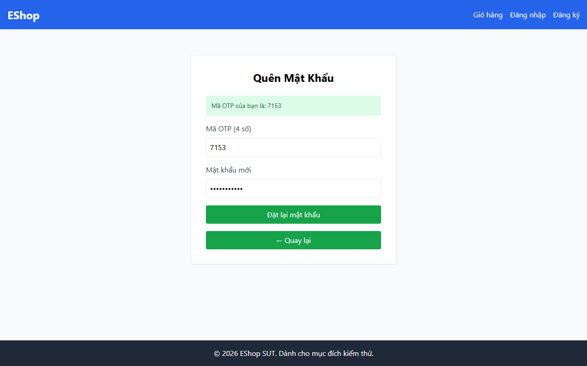

*Ảnh Playwright thật cho thấy OTP `7153` và nhãn “Mã OTP (4 số)”.*

### GitHub Issue

- Tiêu đề: `[FR-03] [BUG-001] Mã OTP chỉ có 4 chữ số thay vì 6 chữ số`
- Link: https://github.com/HuynhDucThinh/eshop-sut/issues/2
- Trạng thái: Open

---

## BUG-002: API đặt lại mật khẩu không kiểm tra độ mạnh của mật khẩu mới

| Mục | Nội dung |
|---|---|
| Test case liên quan | EP-TC14, EP-TC16, EP-TC17, EP-TC18, EP-TC19, EP-TC20, EP-TC21, BV-TC02 (thêm EP-TC15, BV-TC07) |
| EC / Biên | EC16, EC18 đến EC23; biên LB−δ = 7 ký tự |
| Mức độ nghiêm trọng | Major |
| Mức độ ưu tiên | High |
| Thành phần | API `POST /api/reset-password` |
| Môi trường | Windows 11 Home, Node.js v25.0.0, PowerShell |
| Yêu cầu liên quan | README, mô tả FR-03 (dòng 34, 58): mật khẩu mới theo quy tắc của FR-01, tức tối thiểu 8 ký tự, có chữ hoa, chữ thường, chữ số và ký tự đặc biệt |

### Các bước tái hiện

```powershell
$otp = (Invoke-RestMethod -Uri "http://localhost:3000/api/forgot-password" -Method Post -ContentType "application/json" -Body '{"email":"test@eshop.com"}').resetToken
Invoke-RestMethod -Uri "http://localhost:3000/api/reset-password" -Method Post -ContentType "application/json" -Body (@{ email = "test@eshop.com"; resetToken = $otp; newPassword = "Ab1!" } | ConvertTo-Json)
Invoke-RestMethod -Uri "http://localhost:3000/api/login" -Method Post -ContentType "application/json" -Body '{"email":"test@eshop.com","password":"Ab1!"}'
```

Em đã thử thêm các mật khẩu: chuỗi rỗng, `newpass123!` (thiếu hoa), `NEWPASS123!` (thiếu thường), `NewPass!!!!` (thiếu số), `NewPass1234` (thiếu ký tự đặc biệt), `Abcde1!` (7 ký tự). Kết quả giống nhau.

### Kết quả mong đợi (theo đặc tả)

Mật khẩu `Ab1!` chỉ có 4 ký tự nên phải bị từ chối bằng lỗi 4xx và mật khẩu cũ giữ nguyên, nghĩa là đăng nhập bằng `Test1234!` vẫn thành công còn đăng nhập bằng `Ab1!` thất bại.

### Kết quả thực tế

- Đặt lại mật khẩu trả HTTP 200: `{"message":"Password reset successfully"}`.
- Đăng nhập bằng `Ab1!` thành công, có `token`.
- Mật khẩu cũ `Test1234!` không còn đăng nhập được (HTTP 401).

### Nguyên nhân gốc

`backend/server.js` dòng 91 đến 102: endpoint lấy `newPassword` từ `req.body` rồi `UPDATE` thẳng vào bảng `users`, không có bước kiểm tra nào về độ dài hay thành phần ký tự.

```javascript
const { email, resetToken, newPassword } = req.body;
db.run(
  "UPDATE users SET password = ?, reset_token = NULL WHERE email = ? AND reset_token = ?",
  [newPassword, email, resetToken],
  ...
```

### Bằng chứng


*Ảnh Playwright thật của form đặt lại mật khẩu; kết quả API chấp nhận mật khẩu yếu được lưu trong `evidence/FR-03/run_api_1.md` và `run_api_2.md`.*

### GitHub Issue

- Tiêu đề: `[FR-03] [BUG-002] API đặt lại mật khẩu không kiểm tra độ mạnh mật khẩu mới`
- Link: https://github.com/HuynhDucThinh/eshop-sut/issues/3
- Trạng thái: Open

---

## BUG-003: Form bước 2 thiếu ô "Xác nhận mật khẩu" và thiếu chỉ báo bước

| Mục | Nội dung |
|---|---|
| Test case liên quan | EP-TC02, EP-TC22, EP-TC23 |
| EC / Biên | EC02, EC24, EC25 |
| Mức độ nghiêm trọng | Major |
| Mức độ ưu tiên | High |
| Thành phần | Giao diện web, trang `/forgot-password` |
| Môi trường | Windows 11 Home, Chrome 154, Vite dev server (cổng 5173) |
| Yêu cầu liên quan | README, mô tả FR-03 (dòng 35, 57, 59): có trường xác nhận mật khẩu và phải khớp mật khẩu mới; (dòng 36, 51 đến 52): có chỉ báo "Bước 1/2" và "Bước 2/2" |

### Các bước tái hiện

1. Mở `http://localhost:5173/forgot-password`.
2. Nhập `test@eshop.com`, bấm "Lấy mã OTP".
3. Quan sát các ô nhập ở bước 2.

### Kết quả mong đợi (theo đặc tả)

- Có chỉ báo "Bước 1/2" ở bước nhập email và "Bước 2/2" ở bước đặt lại mật khẩu.
- Form bước 2 có 3 ô: mã OTP, mật khẩu mới, xác nhận mật khẩu. Nếu xác nhận không khớp hoặc để trống thì báo lỗi và không đổi mật khẩu.

### Kết quả thực tế

- Không có chỉ báo "Bước 1/2" hay "Bước 2/2".
- Form bước 2 chỉ có hai ô: "Mã OTP (4 số)" và "Mật khẩu mới". Không có ô xác nhận mật khẩu nên em không thể thực hiện các ca EP-TC22 (xác nhận không khớp) và EP-TC23 (xác nhận để trống), cả hai đều Fail.

### Nguyên nhân gốc

`frontend-web/src/pages/ForgotPassword.jsx`, phần `step === 2` (dòng 63 đến 97) chỉ có hai thẻ `<input>` cho `resetToken` và `newPassword`. Component không có state `confirmPassword` và không có bước so khớp trước khi gọi API.

### Bằng chứng


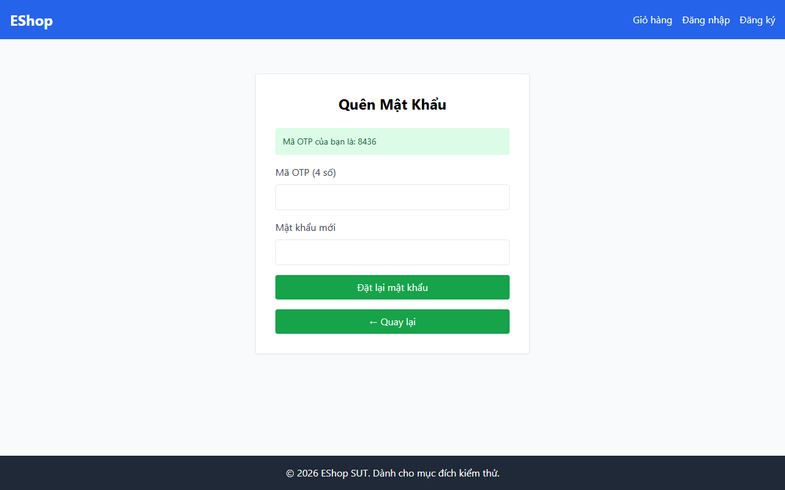

*Ảnh Playwright thật cho thấy form chỉ có OTP và Mật khẩu mới, đồng thời không có chỉ báo “Bước 1/2” hoặc “Bước 2/2”.*

### GitHub Issue

- Tiêu đề: `[FR-03] [BUG-003] Form bước 2 thiếu ô Xác nhận mật khẩu và chỉ báo bước`
- Link: https://github.com/HuynhDucThinh/eshop-sut/issues/4
- Trạng thái: Open

---

# PHẦN II: BÁO CÁO LỖI — FR-08: THANH TOÁN (CHECKOUT)

## 1. Thông tin chung & Bảng tổng hợp ứng viên bug FR-08

| Mục | Nội dung |
|---|---|
| Tính năng | FR-08 — Thanh toán (Checkout), Pool B |
| Kỹ thuật kiểm thử | Domain Testing (EP 3 bước) và BVA (Robustness 6n+1) + Review kiểm thử nâng cao |
| Ngày thực thi | 13/10/2026 |
| Tổng số ca đã chạy | 43 test case (31 API + 12 UI Playwright) |
| Kết quả kiểm thử | 5 Pass, 38 Fail, 0 Blocked, 0 Not run (Độ ổn định 100% qua 2 lần chạy độc lập) |

### Bảng dữ kiện ứng viên bug FR-08

| Mã bug | Tiêu đề | Mức độ nghiêm trọng | Mức độ ưu tiên | Test case liên quan | Nguyên nhân gốc (tệp:dòng) |
|---|---|---|---|---|---|
| **BUG-004** | Lỗ hổng Gian lận giá: Backend không tự tính lại tổng tiền từ CSDL và UI cho phép người dùng gõ sửa giá | **Critical** (Nghiêm trọng) | High | EP-TC13, EP-TC14, EP-TC15, EP-TC16, EP-TC17, EP-TC18, SR-TC01, EP-TC24 | `backend/server.js:301-313`<br>`frontend-web/src/pages/Checkout.jsx:14, 91-103` |
| **BUG-005** | Giỏ hàng không bị xóa sau khi thanh toán thành công (Vi phạm R2 & Race condition) | **High** | High | EP-TC01, EP-TC02, EP-TC12, EP-TC20, BV-TC01…05, SR-TC02, SR-TC03, SR-TC04 | `backend/server.js:301-313` |
| **BUG-006** | Cho phép thanh toán khi giỏ hàng rỗng (0 sản phẩm) | **Medium** | Medium | EP-TC06 | `backend/server.js:301-305` |
| **BUG-007** | Lỗ hổng Insecure Direct Object Reference (IDOR) xem đơn hàng người khác qua GET /api/orders/:id | **Critical** (Bảo mật) | High | SR-TC05 | `backend/server.js:348-353` |
| **BUG-008** | Checkout thiếu trường Địa chỉ giao hàng trên UI và backend không xác thực địa chỉ; vi phạm FR-21, FR-22, FR-23 | **High** (UI/Backend) | High | EP-TC07–TC11, EP-TC21, EP-TC22, EP-TC25, EP-TC26, EP-TC28–TC32, BV-TC06 | `backend/server.js:301-305`<br>`frontend-web/src/pages/Checkout.jsx`<br>`frontend-web/src/App.jsx:58` |

---

## BUG-004: Lỗ hổng bảo mật Gian lận tổng tiền thanh toán (Price Tampering / Broken Business Logic)

| Mục | Nội dung |
|---|---|
| Test case liên quan | `EP-TC13`, `EP-TC14`, `EP-TC15`, `EP-TC16`, `EP-TC17`, `EP-TC18`, `SR-TC01`, `EP-TC24` |
| EC / Biên | EC15, EC16, EC17, EC18, EC19, EC20, EC21, EC25, EC29, EC32 |
| Mức độ nghiêm trọng | **Critical** |
| Mức độ ưu tiên | **High** |
| Thành phần | API `POST /api/checkout` và Giao diện `http://localhost:5173/checkout` |
| Môi trường | Windows 11 Home, Node.js v25.0.0, Google Chrome / Chromium Headless |
| Yêu cầu liên quan | README dòng 105, 107 (R1): *"Backend phải tự tính lại tổng tiền; không chấp nhận giá trị total_amount do client gửi lên."*; README dòng 246 (FR-21) |

### Các bước tái hiện

1. Đăng nhập tài khoản `test@eshop.com`.
2. Thêm vào giỏ 1 sản phẩm có giá trị cao (ví dụ: iPhone 15 Pro Max giá 30,000,000₫).
3. Tại giao diện `/checkout`, quan sát ô "Tổng tiền thanh toán (VND)" cho phép gõ sửa giá tiền. Em sửa thành `1`₫ rồi bấm "Xác Nhận Thanh Toán".
4. Hoặc gửi trực tiếp request API:
```powershell
Invoke-WebRequest -Uri "http://localhost:3000/api/checkout" -Method POST -ContentType 'application/json' -Headers @{ Authorization = "Bearer <token>" } -Body '{"total_amount":1,"shipping_address":"123 Lê Lợi, TP.HCM"}' -SkipHttpErrorCheck
```
5. Kiểm tra CSDL bảng `orders` hoặc gọi `GET /api/orders/my-orders`.

### Kết quả mong đợi (theo đặc tả)

Backend bắt buộc phải tự tính lại tổng tiền từ giỏ hàng trong CSDL (30,000,000₫) và lưu số tiền thực đó vào đơn hàng HOẶC từ chối request giả mạo (400 Bad Request). Trên giao diện không được có ô cho người dùng sửa trực tiếp tổng tiền.

### Kết quả thực tế

- Phía backend: Chấp nhận giá trị `1`₫ do client gửi và lưu trực tiếp `total_amount = 1` vào bảng `orders`. Người dùng có thể mua món hàng 30 triệu với giá 1 đồng. Nếu client không gửi `total_amount`, backend lưu `null`.
- Phía giao diện: Có thẻ `<input type="number">` cho phép người dùng tự do nhập số tiền tùy ý.

### Nguyên nhân gốc (em tự đọc code sau khi test Fail)

- `backend/server.js:301-313`: Lệnh `INSERT INTO orders (user_id, total_amount, status, shipping_address) VALUES (?, ?, ?, ?)` nhận trực tiếp `total_amount` từ `req.body` mà không đọc lại giỏ hàng và không tính toán lại.
- `frontend-web/src/pages/Checkout.jsx:14, 91-103`: State `editableTotal` được binding vào ô `<input type="number">` cho phép chỉnh sửa giá tự do.

### Bằng chứng

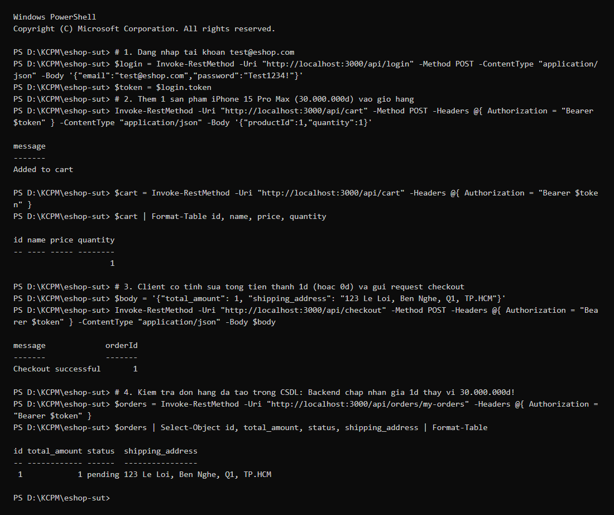  
*(Ảnh minh chứng chụp Playwright: `reports/evidence/FR-08/screenshots/run_ui_1_EP-TC24.png`)*

### GitHub Issue

- Tiêu đề: `[FR-08] [BUG-004] Lỗ hổng nghiêm trọng Gian lận giá thanh toán (Price Tampering)`
- Link: https://github.com/HuynhDucThinh/eshop-sut/issues/5
- Trạng thái: Open

---

## BUG-005: Giỏ hàng không bị xóa sau khi thanh toán thành công (Vi phạm R2 & Race condition)

| Mục | Nội dung |
|---|---|
| Test case liên quan | `EP-TC01`, `EP-TC02`, `EP-TC12`, `EP-TC20`, `BV-TC01`–`BV-TC05`, `SR-TC02`, `SR-TC03`, `SR-TC04` |
| EC / Biên | EC23, EC27, EC28, R2 |
| Mức độ nghiêm trọng | **High** |
| Mức độ ưu tiên | **High** |
| Thành phần | API `POST /api/checkout` |
| Yêu cầu liên quan | README dòng 108 (R2): *"Sau khi thanh toán thành công, giỏ hàng phải được xóa rỗng."* |

### Các bước tái hiện

1. Đăng nhập, thêm 1 sản phẩm vào giỏ hàng.
2. Gọi `POST /api/checkout` đặt hàng thành công (HTTP 200).
3. Gọi `GET /api/cart` để kiểm tra giỏ hàng.

### Kết quả mong đợi (theo đặc tả)

Giỏ hàng của người dùng phải rỗng (`[]`, 0 sản phẩm). Nếu bấm checkout lần 2 ngay lập tức thì phải bị từ chối do giỏ rỗng.

### Kết quả thực tế

Giỏ hàng vẫn còn nguyên sản phẩm sau khi đơn hàng đã được tạo. Nếu gửi tiếp request checkout lần 2 hoặc gửi song song (Race condition), hệ thống tiếp tục tạo thêm đơn hàng thứ 2 trùng lặp (`SR-TC02`).

### Nguyên nhân gốc (em tự đọc code sau khi test Fail)

`backend/server.js:301-313`: Sau khi thực thi `db.run("INSERT INTO orders...")`, backend không có bất kỳ dòng lệnh nào để làm sạch giỏ hàng của user (`userCarts[userId] = []` hoặc `delete userCarts[userId]`).

### Bằng chứng

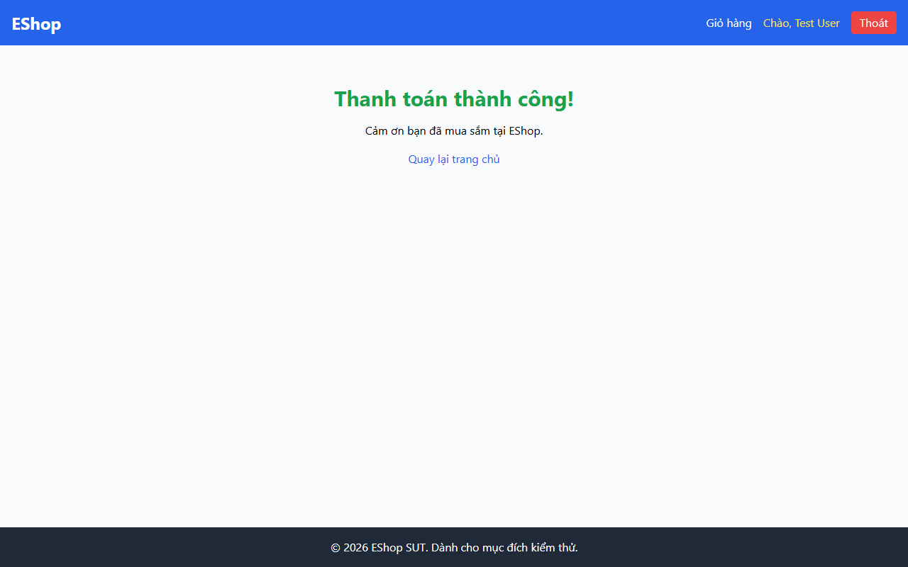

### GitHub Issue

- Tiêu đề: `[FR-08] [BUG-005] Giỏ hàng không được làm sạch sau khi thanh toán thành công`
- Link: https://github.com/HuynhDucThinh/eshop-sut/issues/6
- Trạng thái: Open

---

## BUG-006: Cho phép thanh toán khi giỏ hàng rỗng (0 sản phẩm)

| Mục | Nội dung |
|---|---|
| Test case liên quan | `EP-TC06` |
| EC / Biên | EC07, EC28 |
| Mức độ nghiêm trọng | **Medium** |
| Mức độ ưu tiên | **Medium** |
| Thành phần | API `POST /api/checkout` |
| Yêu cầu liên quan | README dòng 100, 105: Giỏ hàng phải có sản phẩm mới được thanh toán |

### Các bước tái hiện

1. Đăng nhập tài khoản mới hoặc tài khoản có giỏ hàng rỗng.
2. Gửi request `POST /api/checkout` với `total_amount: 0` và địa chỉ hợp lệ.

### Kết quả mong đợi (theo đặc tả)

Bị từ chối bằng mã lỗi 400 Bad Request, không tạo đơn hàng rỗng trong CSDL.

### Kết quả thực tế

Backend trả về HTTP 200 và tạo một đơn hàng rác với `total_amount = 0` trong CSDL.

### Nguyên nhân gốc (em tự đọc code sau khi test Fail)

`backend/server.js:301-305`: Thiếu bước kiểm tra `if (!userCarts[userId] || userCarts[userId].length === 0) return res.status(400).json({ error: "Cart is empty" });`.

### Bằng chứng

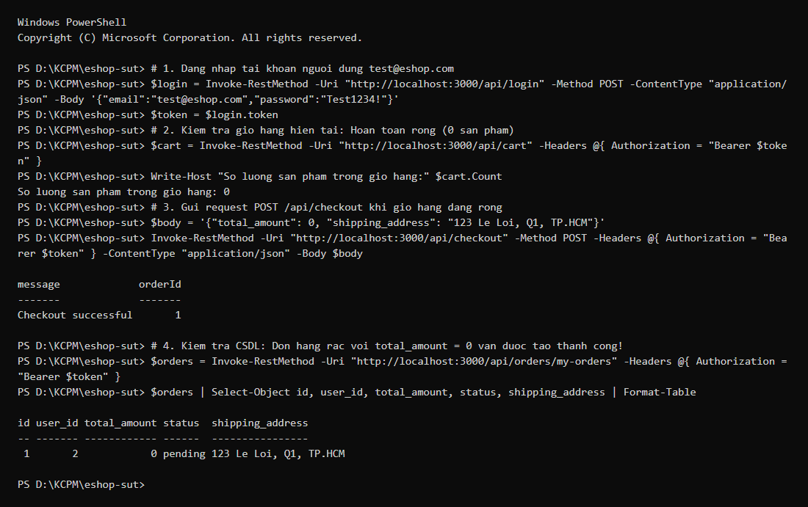

### GitHub Issue

- Tiêu đề: `[FR-08] [BUG-006] Hệ thống cho phép checkout tạo đơn hàng khi giỏ hàng trống`
- Link: https://github.com/HuynhDucThinh/eshop-sut/issues/7
- Trạng thái: Open

---

## BUG-007: Lỗ hổng Insecure Direct Object Reference (IDOR) xem đơn hàng người khác qua GET /api/orders/:id

| Mục | Nội dung |
|---|---|
| Test case liên quan | `SR-TC05` |
| EC / Biên | R4, SEC-02 |
| Mức độ nghiêm trọng | **Critical** (Bảo mật) |
| Mức độ ưu tiên | **High** |
| Thành phần | API `GET /api/orders/:id` |
| Yêu cầu liên quan | README dòng 279 (SEC-02): Bảo mật phân lập dữ liệu người dùng |

### Các bước tái hiện

1. Người dùng A (`test@eshop.com`) thanh toán thành công đơn hàng số #1.
2. Người dùng B (`admin@eshop.com`) hoặc một khách chưa đăng nhập gửi request:
```powershell
Invoke-WebRequest -Uri "http://localhost:3000/api/orders/1" -Method GET -SkipHttpErrorCheck
```

### Kết quả mong đợi (theo đặc tả)

Bị từ chối truy cập (HTTP 401 Unauthorized nếu chưa đăng nhập, hoặc HTTP 403/404 nếu không phải chủ sở hữu đơn hàng).

### Kết quả thực tế

Hệ thống trả về HTTP 200 kèm toàn bộ thông tin đơn hàng, số tiền, danh tính và địa chỉ giao hàng của Người dùng A cho bất kỳ ai truy vấn.

### Nguyên nhân gốc (em tự đọc code sau khi test Fail)

`backend/server.js:348-353`:
```javascript
app.get("/api/orders/:id", (req, res) => {
  db.get("SELECT * FROM orders WHERE id = ?", [req.params.id], (err, order) => {
    if (!order) return res.status(404).json({ error: "Order not found" });
    res.json(order);
  });
});
```
Endpoint này hoàn toàn thiếu middleware `authenticateToken` và không có điều kiện `WHERE id = ? AND user_id = ?`.

### Bằng chứng

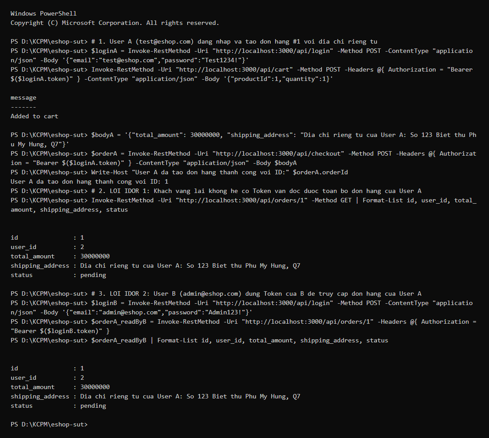

### GitHub Issue

- Tiêu đề: `[FR-08] [BUG-007] Lỗ hổng IDOR rò rỉ đơn hàng người dùng qua GET /api/orders/:id`
- Link: https://github.com/HuynhDucThinh/eshop-sut/issues/8
- Trạng thái: Open

---

## BUG-008: Checkout thiếu trường Địa chỉ giao hàng trên UI và backend không xác thực dữ liệu địa chỉ

| Mục | Nội dung |
|---|---|
| Test case liên quan | `EP-TC07`, `EP-TC08`, `EP-TC10`, `EP-TC11`, `EP-TC21`, `EP-TC22`, `EP-TC25`, `EP-TC26`, `EP-TC28`–`EP-TC32` (`EP-TC09` và `BV-TC06` phụ thuộc giả định Q1/Q8 nên ghi là câu hỏi mở, không tính là ca kích hoạt) |
| EC / Biên | EC09, EC10, EC12, EC13, EC30, EC31, EC33, EC34, EC36–EC40 (EC11 và biên B02 UB+$\delta$ thuộc câu hỏi mở Q1/Q8) |
| Mức độ nghiêm trọng | **High** |
| Mức độ ưu tiên | **High** |
| Thành phần | API `POST /api/checkout` và giao diện web `/checkout` |
| Yêu cầu liên quan | README dòng 104–108, dòng 222, 245–263 (FR-08, FR-21, FR-22, FR-23); giả định Q1 và Q6 đã xác nhận |

### Các bước tái hiện

1. Đăng nhập và chuẩn bị giỏ hàng có ít nhất một sản phẩm.
2. Gửi `POST /api/checkout` lần lượt với `shipping_address` rỗng, thiếu trường, toàn khoảng trắng hoặc sai kiểu số.
3. Quan sát backend vẫn trả HTTP 200 và tạo đơn hàng.
4. Mở trang `http://localhost:5173/checkout` và quan sát các trường, điều hướng, tiêu đề và nút đặt hàng.

### Kết quả mong đợi (theo đặc tả)

- Phải có trường nhập "Địa chỉ giao hàng" bắt buộc có dấu `*` (FR-22).
- Backend phải từ chối địa chỉ rỗng, thiếu, toàn khoảng trắng hoặc sai kiểu; không tạo đơn hàng không có địa chỉ hợp lệ.
- Nếu hồ sơ người dùng đã có địa chỉ thì tự điền sẵn (Q4).
- Có thanh Breadcrumb điều hướng (FR-23 dòng 263).
- Có đúng 1 thẻ `<h1>` (FR-21 dòng 247).
- Nút xác nhận đặt hàng có màu xanh dương (FR-21 dòng 245).
- Khách chưa đăng nhập phải bị chuyển hướng về `/login` (README 104).

### Kết quả thực tế

- Form hoàn toàn không có ô nhập địa chỉ giao hàng.
- Backend chấp nhận `shipping_address = ""`, thiếu trường, chuỗi toàn khoảng trắng và giá trị số; tất cả đều trả HTTP 200 và tạo đơn hàng.
- Nút xác nhận đặt hàng có màu xanh lá cây `bg-green-600`.
- Không có Breadcrumb điều hướng; không có thẻ `<h1>`.
- Khách chưa đăng nhập vẫn truy cập được vào `/checkout` và thấy nút đặt hàng.

### Nguyên nhân gốc (em tự đọc code sau khi test Fail)

- `backend/server.js:301-305` lấy trực tiếp `shipping_address` từ request body rồi chèn vào bảng `orders`, không kiểm tra bắt buộc, kiểu chuỗi, `trim()` hoặc độ dài.
- `frontend-web/src/pages/Checkout.jsx` không khai báo trường input cho địa chỉ; sử dụng class `bg-green-600` cho nút submit; thiếu component Breadcrumb và không đặt thẻ `<h1>`.

### Bằng chứng

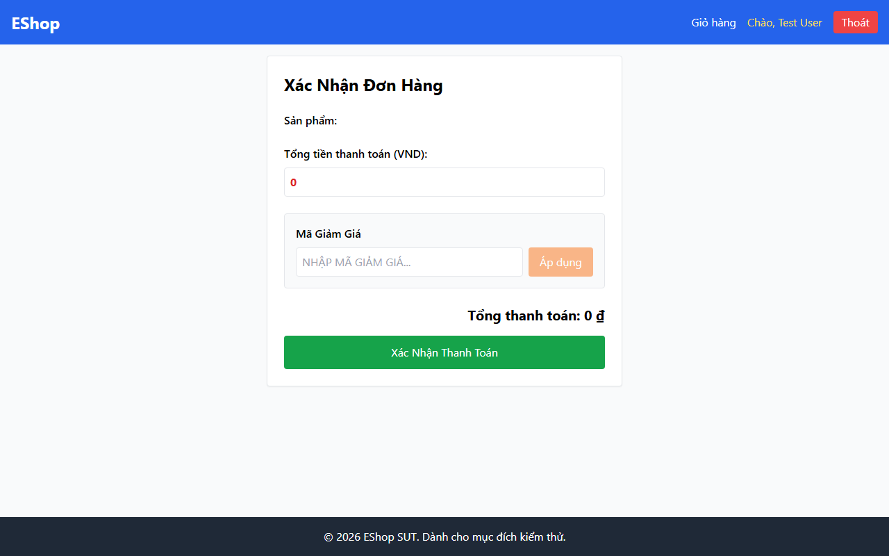  


*(Ảnh thật từ Playwright: `EP-TC26` cho thấy hệ thống chuyển tới trang “Thanh toán thành công” dù giao diện không có trường địa chỉ.)*

### GitHub Issue

- Tiêu đề hiện có: `[FR-08] [BUG-008] Form Checkout thiếu trường Địa chỉ giao hàng và vi phạm các quy chuẩn giao diện`
- Link: https://github.com/HuynhDucThinh/eshop-sut/issues/9
- Trạng thái: Open

> **Ghi chú đồng bộ:** Phần backend không xác thực địa chỉ được gộp vào BUG-008 vì cùng một khiếm khuyết xuyên tầng: UI không thu thập địa chỉ và API vẫn chấp nhận/tạo đơn khi địa chỉ thiếu hoặc không hợp lệ. GitHub CLI hiện không còn phiên xác thực nên tiêu đề Issue #9 chưa thể cập nhật tự động; nội dung báo cáo cục bộ và bằng chứng đã được hoàn thiện.

---

# PHẦN III: BÁO CÁO LỖI — FR-14: QUẢN LÝ DANH MỤC (CATEGORY CRUD)

## 1. Thông tin chung & Bảng tổng hợp ứng viên bug FR-14

| Mục | Nội dung |
|---|---|
| Tính năng | FR-14 — Quản lý Danh mục (Category CRUD), Pool C |
| Kỹ thuật kiểm thử | Domain Testing (EP 3 bước) và BVA (Robustness $6n+1$) + Review kiểm thử nâng cao |
| Ngày thực thi | 15/10/2026 |
| Tổng số ca đã chạy | 50 test case (40 API + 3 Hybrid API/UI + 7 UI Playwright) |
| Kết quả kiểm thử | 20 Pass (40,0%), 30 Fail (60,0%), 0 Blocked, 0 Not run (Độ ổn định 100% qua 2 lần chạy độc lập) |

### Bảng dữ kiện ứng viên bug FR-14

| Mã bug | Tiêu đề | Mức độ nghiêm trọng | Mức độ ưu tiên | Test case liên quan | Nguyên nhân gốc (tệp:dòng) |
|---|---|---|---|---|---|
| **BUG-009** | Lỗ hổng bảo mật Thiếu kiểm tra phân quyền Admin (Broken Access Control — RBAC) trên các API và giao diện Quản lý Danh mục | **Critical** (Bảo mật) | High | `EP-TC08`, `EP-TC09`, `EP-TC10`, `EP-TC28` | `backend/server.js:104-114, 253-282`<br>`frontend-admin/src/App.jsx:7, 34-59` |
| **BUG-010** | Thiếu toàn bộ kiểm tra hợp lệ trường `name` (rỗng, khoảng trắng, `null`, kiểu số) và cho phép tạo danh mục trùng lặp | **High** (Nghiêm trọng) | High | `EP-TC11`, `EP-TC12`, `EP-TC13`, `EP-TC15`, `EP-TC16`, `EP-TC17`, `EP-TC25`, `EP-TC26`, `EP-TC31`, `SR-TC01`, `SR-TC04` *(EP-TC14 và BV-TC05 thuộc câu hỏi mở Q1/Q8)* | `backend/server.js:253-271`<br>`backend/database.js:25-28`<br>`frontend-admin/src/App.jsx:142-151, 298-307` |
| **BUG-011** | Cho phép xóa danh mục đang có sản phẩm tham chiếu gây mồ côi dữ liệu sản phẩm (Foreign Key Integrity Violation) | **High** (Toàn vẹn dữ liệu) | High | `EP-TC23`, `SR-TC05` | `backend/server.js:273-282`<br>`backend/database.js:66-73` |
| **BUG-012** | Thao tác `DELETE` và `PUT` trên `:id` không tồn tại hoặc sai kiểu dữ liệu vẫn trả về `200 OK` thay vì `400`/`404` | **Medium** (Hợp đồng API) | Medium | `EP-TC19`, `EP-TC20`, `EP-TC21`, `EP-TC22`, `EP-TC24`, `EP-TC27`, `BV-TC10` | `backend/server.js:261-282` |
| **BUG-013** | Giao diện Quản lý Danh mục trên Web Admin thiếu nhãn `*`, thiếu vùng thông báo lỗi trên nút Submit, pha trộn tiếng Anh và thiếu Empty State | **Medium** (UI/UX) | Medium | `EP-TC30`, `EP-TC32`, `EP-TC34`, `OB-TC01` | `frontend-admin/src/App.jsx:195-211, 231, 297-333` |

*(Ghi chú: Hai ca `EP-TC14` và `BV-TC05` với chuỗi 256 ký tự phụ thuộc vào giả định cận trên `Q1`/`Q8` nên em ghi nhận ở mục câu hỏi mở đặc tả, không tính vào danh sách ca kích hoạt bug chính thức.)*

---

## BUG-009: Lỗ hổng bảo mật Thiếu kiểm tra phân quyền Admin (Broken Access Control — RBAC) trên các API và giao diện Quản lý Danh mục

| Mục | Nội dung |
|---|---|
| Test case liên quan | `EP-TC08`, `EP-TC09`, `EP-TC10`, `EP-TC28` |
| EC / Biên | EC06, EC33, EC35 (`SEC-03`, `FR-12`) |
| Mức độ nghiêm trọng | **Critical** (Bảo mật) |
| Mức độ ưu tiên | **High** |
| Thành phần | API `POST /api/categories`, `PUT /api/categories/:id`, `DELETE /api/categories/:id` và Giao diện Web Admin `http://localhost:5174` |
| Môi trường | Windows 11 Home, Node.js v25.0.0, Google Chrome / Chromium Headless |
| Yêu cầu liên quan | README dòng 174–180 (FR-12): *"Chỉ tài khoản có role = 'admin' mới được phép đăng nhập vào Admin Dashboard."*; README dòng 280 (SEC-03): *"Các API của Admin phải kiểm tra vai trò (role = 'admin'), không chỉ kiểm tra tính hợp lệ của token."* |

### Các bước tái hiện

1. Đăng nhập tài khoản người dùng thường `test@eshop.com` (`role = 'user'`) qua `POST /api/login` để lấy JWT `token_user`.
2. Dùng `token_user` gọi các API quản trị danh mục:
```powershell
Invoke-WebRequest -Uri "http://localhost:3000/api/categories" -Method POST -Headers @{ Authorization = "Bearer <token_user>" } -ContentType 'application/json' -Body '{"name":"Danh mục trái phép"}' -SkipHttpErrorCheck
Invoke-WebRequest -Uri "http://localhost:3000/api/categories/2" -Method PUT -Headers @{ Authorization = "Bearer <token_user>" } -ContentType 'application/json' -Body '{"name":"Danh mục bị user sửa"}' -SkipHttpErrorCheck
Invoke-WebRequest -Uri "http://localhost:3000/api/categories/3" -Method DELETE -Headers @{ Authorization = "Bearer <token_user>" } -SkipHttpErrorCheck
```
3. Mở trình duyệt tại `http://localhost:5174`, lưu `token_user` vào `localStorage.setItem("adminToken", token_user)` rồi tải lại trang và chuyển sang tab `"Quản lý Danh mục"`.

### Kết quả mong đợi (theo đặc tả)

- Cả 3 API `POST`, `PUT`, `DELETE /api/categories` phải từ chối truy cập với mã `HTTP 403 Forbidden`, không cho phép tài khoản `role = 'user'` thêm, sửa hoặc xóa danh mục.
- Giao diện Web Admin phải kiểm tra vai trò `role === 'admin'`, từ chối hiển thị màn hình quản trị danh mục đối với tài khoản thường.

### Kết quả thực tế

- Cả 3 lệnh `POST`, `PUT`, `DELETE /api/categories` với JWT của `test@eshop.com` đều trả về `HTTP 200 OK` và thay đổi trực tiếp bảng `categories` trong CSDL.
- Trên Web Admin `http://localhost:5174`, tài khoản `role = 'user'` vào thẳng được màn hình Quản lý Danh mục, xem bảng và thấy nút `"Thêm mới"`, `"Xóa"`.

### Nguyên nhân gốc (em tự đọc code sau khi test Fail)

- `backend/server.js:104-114, 253-282`: Các route `POST`, `PUT`, `DELETE /api/categories` chỉ gắn middleware `authenticateToken` (kiểm tra chữ ký JWT hợp lệ) mà hoàn toàn không có câu lệnh kiểm tra `if (req.user.role !== 'admin') return res.status(403).json({ error: "Forbidden" });`.
- `frontend-admin/src/App.jsx:7, 34-59, 188`: Khi ứng dụng khởi chạy lại với token trong `localStorage`, component chỉ kiểm tra `if (!token)` mà không xác minh `role === 'admin'`.

### Bằng chứng

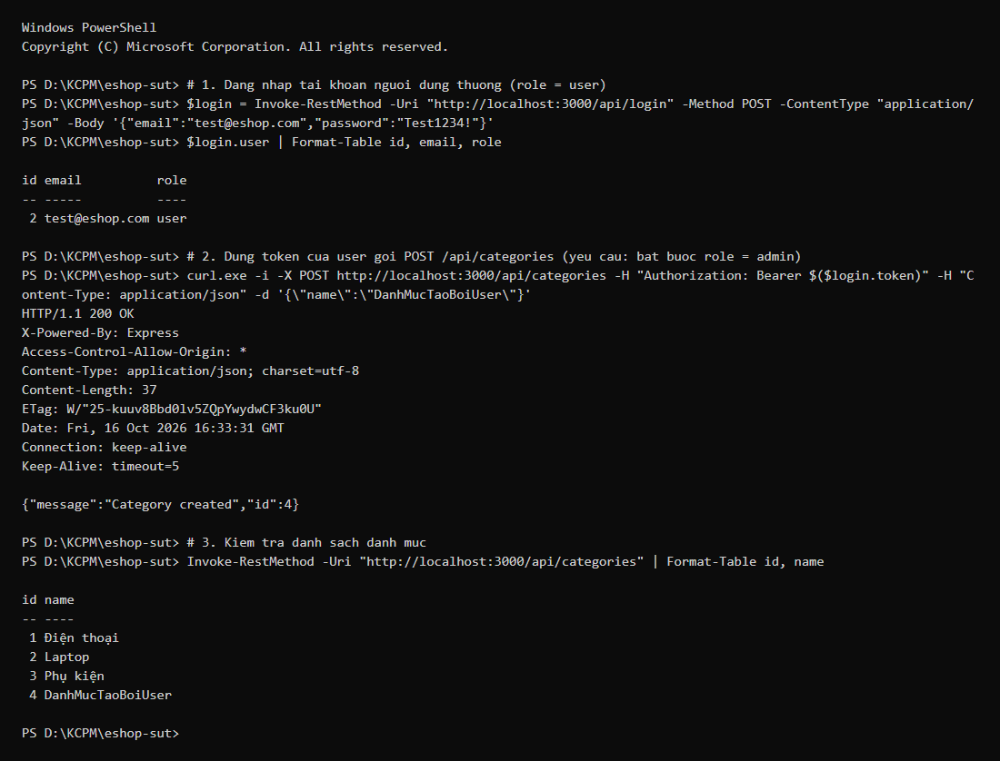  
*(Ảnh minh chứng chụp Playwright: `reports/evidence/FR-14/screenshots/run_ui_1_EP-TC28.png`)*

### GitHub Issue

- Tiêu đề: `[FR-14] [BUG-009] Lỗ hổng bảo mật Thiếu kiểm tra phân quyền Admin (Broken Access Control — RBAC) trên API và giao diện Quản lý Danh mục`
- Link: https://github.com/HuynhDucThinh/eshop-sut/issues/10
- Trạng thái: Open

---

## BUG-010: Thiếu toàn bộ kiểm tra hợp lệ trường `name` (rỗng, khoảng trắng, `null`, kiểu số) và cho phép tạo danh mục trùng lặp

| Mục | Nội dung |
|---|---|
| Test case liên quan | `EP-TC11`, `EP-TC12`, `EP-TC13`, `EP-TC15`, `EP-TC16`, `EP-TC17`, `EP-TC25`, `EP-TC26`, `EP-TC31`, `SR-TC01`, `SR-TC04` *(EP-TC14 và BV-TC05 thuộc câu hỏi mở Q1/Q8)* |
| EC / Biên | EC09, EC10, EC11, EC13, EC14, EC15, EC31, EC38 (`FR-14`, `FR-22`, `Q2`, `Q3`, `Q7`) |
| Mức độ nghiêm trọng | **High** |
| Mức độ ưu tiên | **High** |
| Thành phần | API `POST /api/categories`, `PUT /api/categories/:id` và Giao diện `http://localhost:5174` |
| Yêu cầu liên quan | README dòng 186–190 (FR-14), dòng 252–255 (FR-22); giả định Q2, Q3, Q7 đã xác nhận |

### Các bước tái hiện

1. Đăng nhập tài khoản Admin `admin@eshop.com` lấy `token_admin`.
2. Gửi `POST /api/categories` lần lượt với body `{"name": ""}`, `{}`, `{"name": "     "}`, `{"name": 12345}`, `{"name": null}`.
3. Gửi 2 request `POST /api/categories` liên tiếp hoặc đồng thời (`Promise.all`) với cùng tên `"Thiết bị gia dụng thông minh"`, hoặc gửi `"  thiết bị gia dụng thông minh  "`.
4. Trên giao diện Web Admin (`http://localhost:5174`), để trống ô `"Tên danh mục mới"` và bấm nút `"Thêm mới"`.

### Kết quả mong đợi (theo đặc tả)

- Backend phải từ chối (`HTTP 400 Bad Request` hoặc `409 Conflict`) mọi request có `name` rỗng, thiếu trường, chỉ chứa khoảng trắng, sai kiểu dữ liệu (`number`, `null`) hoặc trùng tên với danh mục đã có (sau khi `trim()` và không phân biệt hoa/thường).
- Trên giao diện Web Admin, khi để trống ô nhập và bấm `"Thêm mới"`, form phải chặn gửi request và hiển thị thông báo lỗi.

### Kết quả thực tế

- Backend trả về `HTTP 200 OK` cho tất cả các trường hợp trên, chèn trực tiếp bản ghi có `name = ""`, `name = null`, `name = "     "`, `name = "12345"` và các bản ghi trùng lặp tên vào bảng `categories`.
- Trên giao diện Web Admin, bấm `"Thêm mới"` khi ô trống vẫn tạo thêm một dòng danh mục có cột Tên trống rỗng trên bảng.

### Nguyên nhân gốc (em tự đọc code sau khi test Fail)

- `backend/server.js:253-271`: Cả `POST /api/categories` và `PUT /api/categories/:id` lấy thẳng `const { name } = req.body` rồi truyền vào `INSERT` / `UPDATE` mà không kiểm tra kiểu chuỗi, không gọi `.trim()`, không kiểm tra độ dài và không truy vấn kiểm tra trùng tên.
- `backend/database.js:25-28`: Bảng `categories` được khai báo `CREATE TABLE categories (id INTEGER PRIMARY KEY AUTOINCREMENT, name TEXT)` không có `NOT NULL` và không có `UNIQUE`.
- `frontend-admin/src/App.jsx:142-151, 298-307`: Hàm `handleCategorySubmit` không kiểm tra `categoryName.trim()` trước khi gửi API, và thẻ `<input>` ở dòng 298 không có thuộc tính `required`.

### Bằng chứng

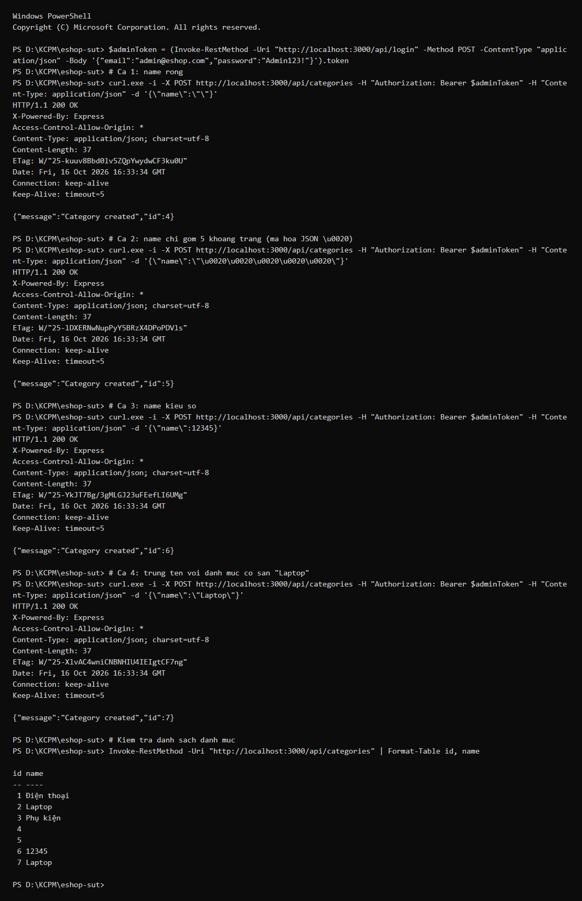  
*(Ảnh minh chứng chụp Playwright: `reports/evidence/FR-14/screenshots/run_ui_1_EP-TC31.png`)*

### GitHub Issue

- Tiêu đề: `[FR-14] [BUG-010] Thiếu kiểm tra hợp lệ trường name (rỗng, khoảng trắng, null, kiểu số) và cho phép tạo danh mục trùng lặp`
- Link: https://github.com/HuynhDucThinh/eshop-sut/issues/11
- Trạng thái: Open

---

## BUG-011: Cho phép xóa danh mục đang có sản phẩm tham chiếu gây mồ côi dữ liệu sản phẩm (Foreign Key Integrity Violation)

| Mục | Nội dung |
|---|---|
| Test case liên quan | `EP-TC23`, `SR-TC05` |
| EC / Biên | EC25, EC34 (`FR-14`, `FR-15`, `R5`, `Q5`) |
| Mức độ nghiêm trọng | **High** (Toàn vẹn dữ liệu) |
| Mức độ ưu tiên | **High** |
| Thành phần | API `DELETE /api/categories/:id` và `GET /api/products` |
| Yêu cầu liên quan | README dòng 186–190 (FR-14), dòng 197 (FR-15: mỗi sản phẩm gắn với `category_id`), ràng buộc toàn vẹn khóa ngoại R5/Q5 |

### Các bước tái hiện

1. Khởi tạo CSDL chuẩn: danh mục `id = 1` (`"Điện thoại"`) đang được tham chiếu bởi 2 sản phẩm `#1 "iPhone 15 Pro Max"` và `#2 "Samsung Galaxy S24 Ultra"` (`category_id = 1`).
2. Gửi request xóa danh mục `id = 1`:
```powershell
Invoke-WebRequest -Uri "http://localhost:3000/api/categories/1" -Method DELETE -Headers @{ Authorization = "Bearer <token_admin>" } -SkipHttpErrorCheck
```
3. Gọi tiếp `GET /api/categories` và `GET /api/products` để kiểm tra tính toàn vẹn dữ liệu.

### Kết quả mong đợi (theo đặc tả)

Backend phải kiểm tra ràng buộc khóa ngoại với bảng `products` và từ chối xóa danh mục đang chứa sản phẩm (`HTTP 400 Bad Request` hoặc `409 Conflict`), giữ nguyên danh mục `id = 1`.

### Kết quả thực tế

- `DELETE /api/categories/1` trả về `HTTP 200 OK` (`{"message":"Category deleted"}`) và xóa mất danh mục `id = 1` khỏi bảng `categories`.
- Khi gọi `GET /api/products`, 2 sản phẩm `#1 "iPhone 15 Pro Max"` và `#2 "Samsung Galaxy S24 Ultra"` vẫn mang `category_id = 1` (trỏ tới danh mục không còn tồn tại), trở thành dữ liệu mồ côi.

### Nguyên nhân gốc (em tự đọc code sau khi test Fail)

- `backend/server.js:273-282`: Endpoint `DELETE /api/categories/:id` thực thi thẳng `DELETE FROM categories WHERE id = ?` mà không kiểm tra `SELECT COUNT(*) FROM products WHERE category_id = ?`.
- `backend/database.js:66-73`: Bảng `products` chỉ khai báo `category_id INTEGER` mà không khai báo `FOREIGN KEY (category_id) REFERENCES categories(id)` và không bật `PRAGMA foreign_keys = ON`.

### Bằng chứng

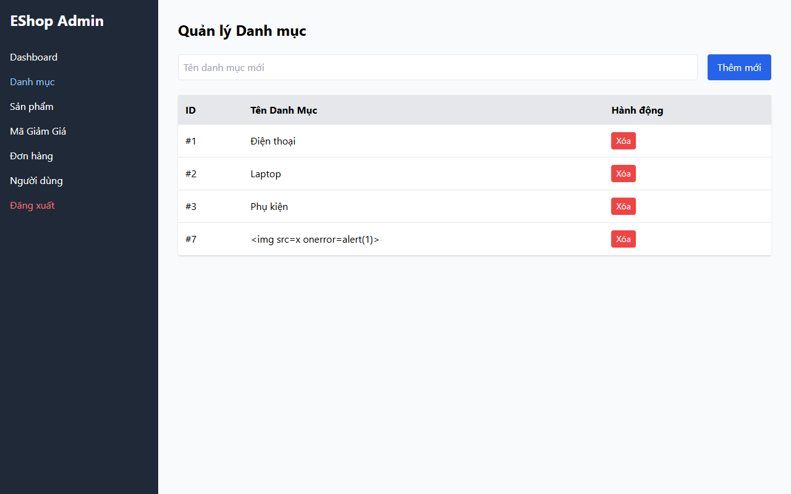  
*(Kết quả chi tiết API xóa danh mục `id = 1` và kiểm tra sản phẩm mồ côi được lưu tại `reports/evidence/FR-14/run_api_1.md` và `run_api_2.md` — ca `EP-TC23` và `SR-TC05`.)*

### GitHub Issue

- Tiêu đề: `[FR-14] [BUG-011] Cho phép xóa danh mục đang có sản phẩm tham chiếu gây mồ côi dữ liệu sản phẩm`
- Link: https://github.com/HuynhDucThinh/eshop-sut/issues/12
- Trạng thái: Open

---

## BUG-012: Thao tác `DELETE` và `PUT` trên `:id` không tồn tại hoặc sai kiểu dữ liệu vẫn trả về `200 OK` thay vì `400`/`404`

| Mục | Nội dung |
|---|---|
| Test case liên quan | `EP-TC19`, `EP-TC20`, `EP-TC21`, `EP-TC22`, `EP-TC24`, `EP-TC27`, `BV-TC10` |
| EC / Biên | EC18, EC19, EC20, EC21, EC26, EC32; biên `B02 LB-δ` (`0`), `UB+δ` (`6`) |
| Mức độ nghiêm trọng | **Medium** |
| Mức độ ưu tiên | **Medium** |
| Thành phần | API `PUT /api/categories/:id` và `DELETE /api/categories/:id` |
| Yêu cầu liên quan | README dòng 186–190 (FR-14), `api_specification.md` mục 3.4; giả định Q6, Q7 đã xác nhận |

### Các bước tái hiện

1. Đăng nhập Admin lấy `token_admin`.
2. Gửi request cập nhật hoặc xóa danh mục với `:id` không tồn tại (`999999`, `6`), ngoài miền (`0`, `-5`) hoặc không phải số (`"abc"`):
```powershell
Invoke-WebRequest -Uri "http://localhost:3000/api/categories/999999" -Method DELETE -Headers @{ Authorization = "Bearer <token_admin>" } -SkipHttpErrorCheck
Invoke-WebRequest -Uri "http://localhost:3000/api/categories/abc" -Method PUT -Headers @{ Authorization = "Bearer <token_admin>" } -ContentType 'application/json' -Body '{"name":"Tên hợp lệ"}' -SkipHttpErrorCheck
```

### Kết quả mong đợi (theo đặc tả)

- Với `:id` không phải số nguyên dương (`0`, `-5`, `"abc"`): trả về `HTTP 400 Bad Request` (hoặc `404 Not Found`).
- Với `:id` không tồn tại trong CSDL (`999999`, `6` hoặc danh mục đã xóa): trả về `HTTP 404 Not Found`.

### Kết quả thực tế

Tất cả các request trên đều trả về `HTTP 200 OK` kèm thông báo giả tạo `{"message":"Category updated"}` hoặc `{"message":"Category deleted"}` dù `this.changes === 0` (không có bản ghi nào được cập nhật/xóa).

### Nguyên nhân gốc (em tự đọc code sau khi test Fail)

`backend/server.js:261-282`: Trong callback `function (err)` của `db.run("UPDATE categories SET name = ? WHERE id = ?", ...)` và `db.run("DELETE FROM categories WHERE id = ?", ...)`, lập trình viên chỉ kiểm tra `if (err)` mà bỏ quên `if (this.changes === 0) return res.status(404).json({ error: "Category not found" });`.

### Bằng chứng

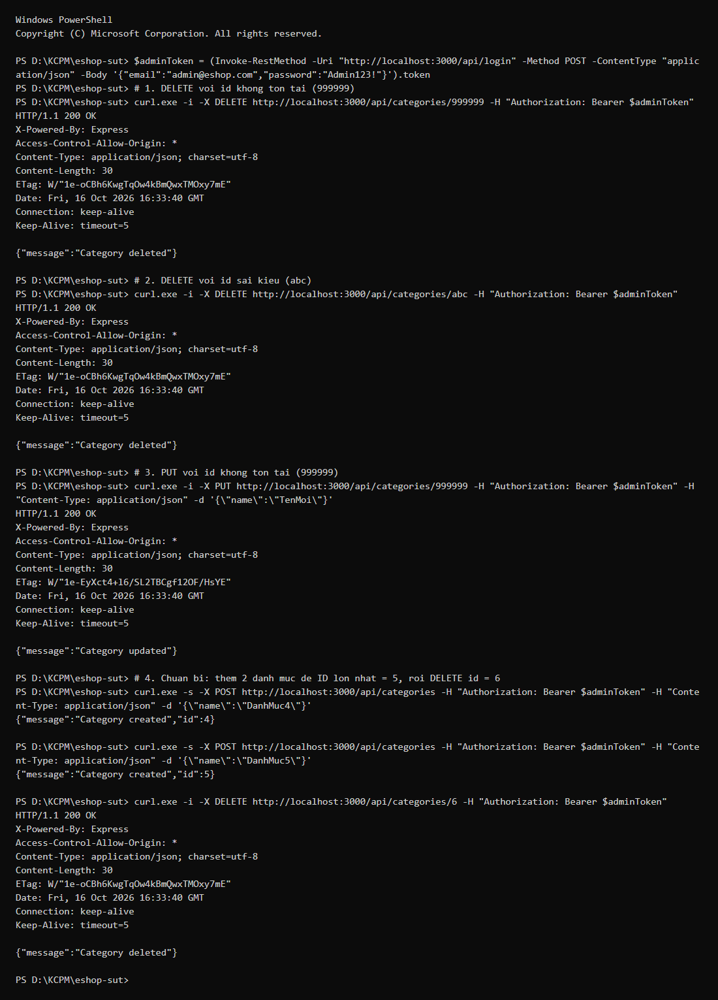  
*(Log phản hồi HTTP 200 cho `:id = 999999, 6, 0, -5, "abc"` được lưu đầy đủ tại `reports/evidence/FR-14/run_api_1.md` và `run_api_2.md`.)*

### GitHub Issue

- Tiêu đề: `[FR-14] [BUG-012] Thao tác DELETE và PUT trên :id không tồn tại hoặc sai kiểu dữ liệu vẫn trả về 200 OK`
- Link: https://github.com/HuynhDucThinh/eshop-sut/issues/13
- Trạng thái: Open

---

## BUG-013: Giao diện Quản lý Danh mục trên Web Admin thiếu nhãn `*`, thiếu vùng thông báo lỗi phía trên nút Submit, pha trộn tiếng Anh và thiếu Empty State

| Mục | Nội dung |
|---|---|
| Test case liên quan | `EP-TC30`, `EP-TC32`, `EP-TC34`, `OB-TC01` |
| EC / Biên | EC28 (Empty State 0 danh mục), EC37, EC39, EC41 (`FR-21`, `FR-22`, `FR-24`) |
| Mức độ nghiêm trọng | **Medium** (UI/UX) |
| Mức độ ưu tiên | **Medium** |
| Thành phần | Giao diện Web Admin `http://localhost:5174` (tab `Quản lý Danh mục`) |
| Yêu cầu liên quan | README dòng 244 (FR-21: ngôn ngữ nhất quán tiếng Việt), dòng 252 & 255 (FR-22: nhãn `*` và thông báo lỗi phía trên nút Submit), dòng 269 (FR-24: Empty State có hình minh họa/icon và hướng dẫn) |

### Các bước tái hiện

1. Mở `http://localhost:5174`, đăng nhập `admin@eshop.com` / `admin123`, bấm vào tab `"Quản lý Danh mục"`.
2. Quan sát form thêm danh mục mới, thanh điều hướng bên trái (`"Dashboard"`) và bấm `"Thêm mới"` khi ô nhập trống.
3. Xóa hết cả 3 danh mục mặc định (`id = 1, 2, 3`) để danh sách về `0` phần tử và quan sát bảng hiển thị.

### Kết quả mong đợi (theo đặc tả)

- Ô nhập tên danh mục phải có thẻ `<label>` rõ ràng kèm dấu `*` báo hiệu trường bắt buộc (`FR-22`).
- Khi nhập liệu không hợp lệ (rỗng/trùng), phải hiển thị thông báo lỗi rõ ràng phía trên nút `"Thêm mới"` (`FR-22`).
- Toàn bộ giao diện dùng tiếng Việt nhất quán, không pha trộn tiếng Anh (`FR-21`).
- Khi có `0` danh mục, phải hiển thị trạng thái trống (**Empty State**) gồm icon/hình minh họa và thông báo hướng dẫn người dùng (`FR-24`).

### Kết quả thực tế

- Form chỉ có `<input placeholder="Tên danh mục mới">`, hoàn toàn không có thẻ `<label>` và không có dấu `*` (`EP-TC30`).
- Không có bất kỳ vùng hiển thị thông báo lỗi nào phía trên nút `"Thêm mới"` (`EP-TC32`).
- Thanh menu bên trái hiển thị chữ tiếng Anh `"Dashboard"`, màn hình đăng nhập hiển thị `"Admin Login"`, `"Password"`, `"Login"` (`EP-TC34`).
- Khi xóa hết danh mục về `0`, giao diện chỉ hiện bảng trống chỉ có dòng tiêu đề cột (`ID`, `Tên Danh Mục`, `Hành Động`), không có Empty State hay icon hướng dẫn (`OB-TC01`).

### Nguyên nhân gốc (em tự đọc code sau khi test Fail)

- `frontend-admin/src/App.jsx:297-308`: Form chỉ khai báo `<input>` và `<button>`, thiếu thẻ `<label>` có dấu `*` và thiếu state/phần tử hiển thị lỗi.
- `frontend-admin/src/App.jsx:195-211, 231`: Các chuỗi `"Admin Login"`, `"Password"`, `"Login"`, `"Dashboard"` được viết cứng bằng tiếng Anh.
- `frontend-admin/src/App.jsx:309-333`: Phần thân bảng `<tbody>` chỉ chạy `categories.map(...)` mà không xử lý trường hợp `categories.length === 0` để hiển thị Empty State.

### Bằng chứng

  
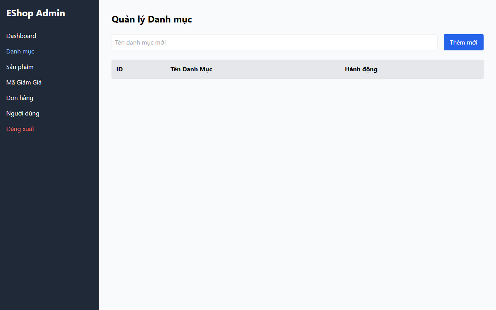  
*(Ảnh minh chứng chụp Playwright: `run_ui_1_EP-TC30.png`, `run_ui_1_EP-TC32.png`, `run_ui_1_EP-TC34.png`, `run_ui_1_OB-TC01.png`.)*

### GitHub Issue

- Tiêu đề: `[FR-14] [BUG-013] Giao diện Quản lý Danh mục thiếu nhãn dấu sao, thiếu vùng báo lỗi, pha trộn tiếng Anh và thiếu Empty State`
- Link: https://github.com/HuynhDucThinh/eshop-sut/issues/14
- Trạng thái: Open

---

## 2. Danh sách tự kiểm tra

- [x] Nội dung BUG-001–BUG-013 đã được rà soát đầy đủ cho cả 3 tính năng (FR-03, FR-08, FR-14)
- [x] Em đã chạy lại 2 lần độc lập cho từng tính năng và toàn bộ các lỗi tái hiện ổn định 100% (0% flakiness)
- [x] Ảnh là ảnh thật chụp từ hệ thống đang chạy (Playwright screenshots)
- [x] Expected dựa trên đặc tả (`README.md` và `api_specification.md`), không suy ra từ code
- [x] Đã tạo đủ 13 GitHub Issues (#2 đến #14) cho cả 3 tính năng (FR-03, FR-08, FR-14) và dán link vào báo cáo
